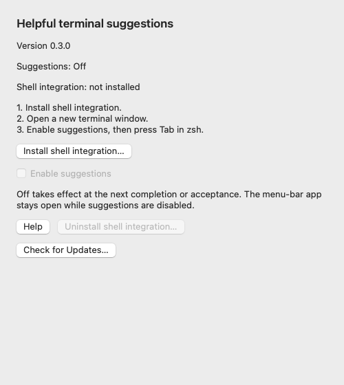
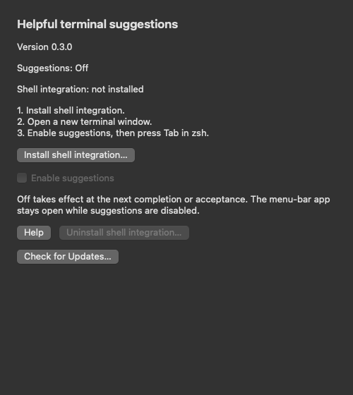

# Terminal Helper

**Helpful terminal suggestions, with one switch to turn them off.**

## Install on your Mac

[**Download for Mac — v0.3.0 →**](https://github.com/denysshcherbak4/terminal-helper/releases/download/v0.3.0/Terminal-Helper-0.3.0-universal.dmg) · [Releases and checksums](https://github.com/denysshcherbak4/terminal-helper/releases)

**Free community beta · macOS 13+ · Apple Silicon and Intel · no Xcode, Python, Node, or app account**

1. Download the **DMG** from this repository's release. Public downloads require no GitHub sign-in.
2. Open it and drag **Terminal Helper** to **Applications inside your home folder** (`~/Applications`; create it in Finder if needed). This is recommended for updates without administrator rights. `/Applications` also works when your account owns and can write this app.
3. Open Terminal Helper. This free build is **ad-hoc signed, not notarized**. If macOS blocks it as an unidentified developer and you trust the exact download, use **System Settings → Privacy & Security → Open Anyway**, then confirm **Open**. [Apple explains this per-app approval](https://support.apple.com/102445).
4. Click **>_ menu-bar icon → Settings → Install shell integration**. Choose Home unless you configured a custom ZDOTDIR.
5. Open a **new terminal window**, then enable suggestions. **Tab** suggests, **arrows** select, **Enter** accepts text, **Escape** cancels. A separate Enter executes.

A free signature does not identify the publisher to Apple or provide malware notarization. Never override a malware/damaged-app warning, globally disable Gatekeeper or remove quarantine. Per-app approval may be needed again after an update and can be unavailable on managed Macs. [Installation help](Docs/INSTALLATION.md)

**Version 0.3.0 is published.** The direct download above includes in-place installation for subsequent updates. [Release notes and verification](https://github.com/denysshcherbak4/terminal-helper/releases/tag/v0.3.0).

## Update without building anything

Choose **Check for Updates…** in the menu-bar app, or run this after installing integration:

```sh
terminal-helper version
terminal-helper check
terminal-helper update
```

**Already using v0.2? One final manual upgrade is required.** Run the old update command to verify and open the v0.3 DMG. Disable and Quit, replace the app in Finder, reopen, update integration if prompted and restart shells. The installed v0.2 command cannot acquire new behavior merely because this repository changed.

**In v0.3 and later**, an explicit update action verifies and installs a newer app in place at `~/Applications/Terminal Helper.app` or an eligible user-owned `/Applications/Terminal Helper.app`. It retains an app backup, refreshes exact owned integration data without editing `.zshrc` or settings, and reopens through macOS Launch Services. **Suggestions remain Off: restart shells, then enable them.** Unsupported locations or permissions are refused without elevation. macOS approval may still be required.

There are no timers, startup checks or background downloads. A maintainer must publish a new version before it is offered. Validation failures leave the installed app untouched; handled installation failures roll back. A retained backup supports interrupted-update recovery without promising a crash-proof app-and-integration transaction. [Update and recovery details](Docs/UPDATES.md) · [Maintainer release steps](Docs/RELEASING.md)

<details>
<summary>See the native app</summary>




</details>

## What it does

Terminal Helper is a native menu-bar app for interactive zsh. Terminal.app is the primary target; full native-terminal/assistive-technology checks remain in the [manual checklist](Docs/MANUAL-VERIFICATION.md).

- Complete real files, directories, executable names, and configured command-specific definitions such as Git.
- Offer labelled, one-edit corrections for a missing final path component. Existing valid paths are never replaced with fuzzy alternatives.
- Show reliable descriptions supplied by configured completion definitions.
- Complete CSV, Parquet and notebook filenames as ordinary files; it does not inspect Python/Jupyter objects.

Acceptance edits the buffer without executing it. Unsupported expressions retain input. Corrections do not recurse, decline above 256 sibling entries, and offer at most 20 results. Native/third-party completion can still be expensive on large or remote directories.

## One switch

**On:** assistance is available in integrated interactive shells.

**Off:** no automatic suggestion generation, directory scanning, helper processes, polling or network requests. Tab is inert. The idle controller remains resident and uses memory. Explicit install/removal and requested update commands still work; an explicit update action contacts GitHub even while suggestions are Off.

**Disable and Quit:** save Off, terminate owned installer workers and exit. Shells recheck state at their next completion/acceptance interaction. Missing or malformed state disables assistance; a controller crash can leave the last enabled state.

## Remove it

Choose **Uninstall shell integration** in Settings using the original configuration folder. Restart shells, then delete the app. Unrelated configuration and uniquely named backups remain intact. Downloaded update folders and retained `.Terminal-Helper-update-<UUID>` app-backup folders beside the app can be deleted separately when no longer needed.

Install/repair/uninstall are repeatable, serialize their own operations and refuse unsafe or detected changed targets. A busy/stale lock is refused rather than stolen; see [recovery](Docs/TROUBLESHOOTING.md).

## Privacy and security

No telemetry, history/command collection, cloud AI, database, whole-disk index, global keyboard monitor, Accessibility permission or screen recording. Suggestions run locally.

Only a requested update contacts GitHub/CDN, which sees normal request metadata such as your IP address. Commands, history, environment, private filenames and configuration are never sent. Checksums detect mismatched bytes; they do not establish a trusted publisher identity. Third-party completion code retains its own trust boundary.

[Privacy](PRIVACY.md) · [Security](SECURITY.md) · [Report vulnerabilities privately](https://github.com/denysshcherbak4/terminal-helper/security/advisories/new). GitHub secret scanning and push protection are enabled.

## Verification and development

[CI, measurements and compatibility](Docs/VERIFICATION.md) · [Architecture](Docs/ARCHITECTURE.md) · [Contributing](CONTRIBUTING.md) · [Roadmap](Docs/ROADMAP.md)

ARM/Intel macOS CI covers actual PTY/ZLE interaction, installer recovery, management-command quoting, update metadata/network/checksum bounds, private files and quarantine, native state/Settings/lifecycle, installer validation/swap/rollback fixtures, rendered appearance and DMG verification. A skipped Terminal.app test is not native-terminal validation.

Targets remain added startup p95 ≤30 ms and first useful suggestion p95 ≤100 ms. Historical runs missed startup and unconfigured-first-use targets. Exact-source artifacts include raw logs/measurements; a green build does not establish Apple trust or every native user flow.

Run these commands **only on a disposable remote macOS runner**, with no running Terminal Helper instance, no existing `~/Applications/Terminal Helper.app` and no `~/Library/Application Support/Terminal Helper`. The updater fixtures create and remove data in the runner account's **actual home**, not just a temporary directory. Do not remove a real installation to satisfy their guards, and do not run them on a personal Mac. A GUI session is needed for the controller handoff.

```sh
bash Scripts/build.sh
python3 Tests/Shell/test_pty.py
python3 Tests/Shell/test_install.py
python3 Tests/Shell/test_cli.py
swiftc App/State.swift App/Updates.swift App/UpdateInstaller.swift Tests/Updates/main.swift -o build/update-tests -framework AppKit -framework CoreServices
build/update-tests
swiftc App/State.swift App/Updates.swift App/UpdateInstaller.swift Tests/UpdateInstaller/main.swift -o build/update-installer-tests -framework AppKit -framework CoreServices
build/update-installer-tests
swiftc App/State.swift App/Updates.swift App/UpdateInstaller.swift Tests/UpdateController/main.swift -o build/update-controller-tests -framework AppKit -framework CoreServices
build/update-controller-tests "$PWD/dist/Terminal Helper.app"
"dist/Terminal Helper.app/Contents/MacOS/TerminalHelper" --self-test
"dist/Terminal Helper.app/Contents/MacOS/TerminalHelper" --settings-self-test
"dist/Terminal Helper.app/Contents/MacOS/TerminalHelper" --lifecycle-test
"dist/Terminal Helper.app/Contents/MacOS/TerminalHelper" --termination-self-test
"dist/Terminal Helper.app/Contents/MacOS/TerminalHelper" --update-cancel-self-test
python3 Tests/Performance/measure.py
bash Scripts/package.sh
```

The controller fixture runs **after the app build** and opens an unquarantined CI-built copy through Launch Services. This verifies the quit/Off handoff, not a downloaded app's Gatekeeper approval. The standalone update test programs all require the three shared Swift sources shown above. Record results only from the final exact-source complete CI run.

The app targets macOS 13 and contains arm64/x86_64. Editable icon sources are in Assets/ and App/Icon.swift. Licensed under [MIT](LICENSE).
